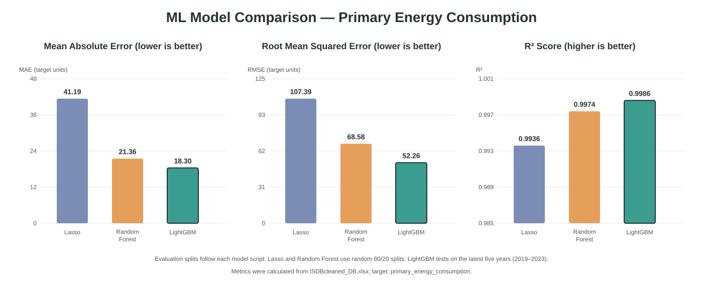

# ML Model Comparison — Primary Energy Consumption

Evaluation splits follow each model script: Lasso and Random Forest use random 80/20 splits; LightGBM tests on the latest five years (2019–2023). Metrics use `ISDBcleaned_DB.xlsx` and target `primary_energy_consumption`.
